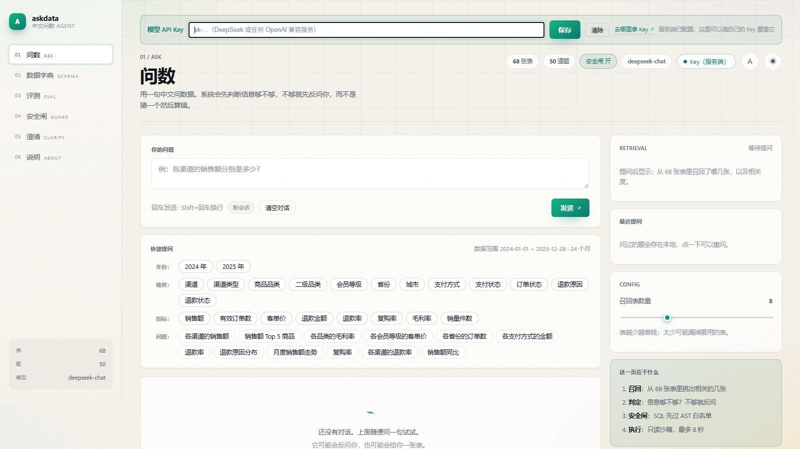
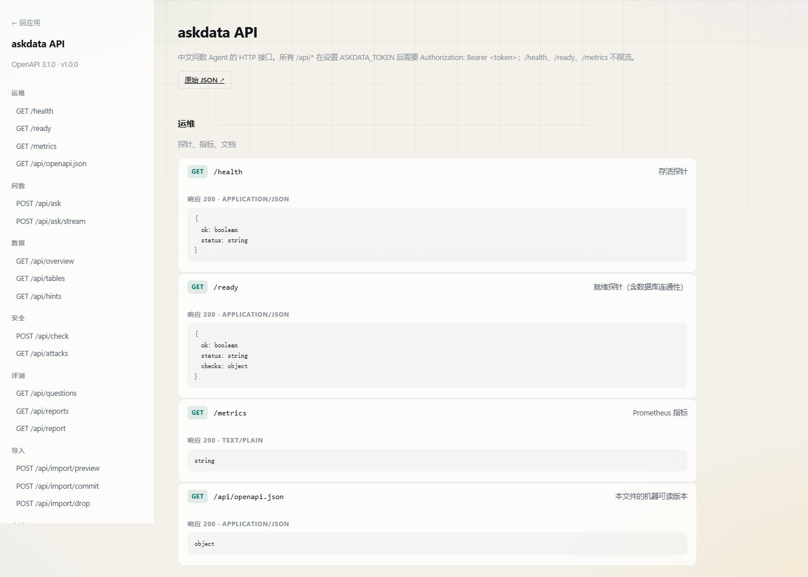
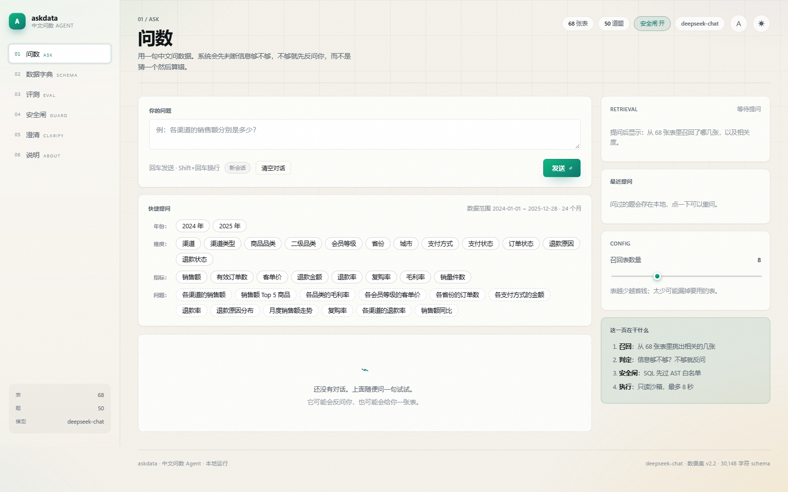
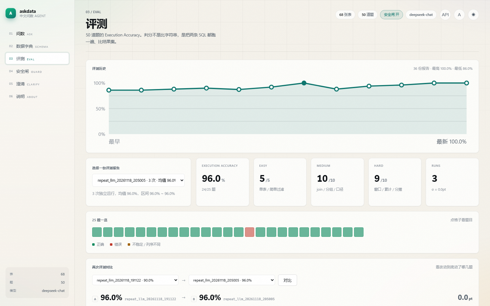
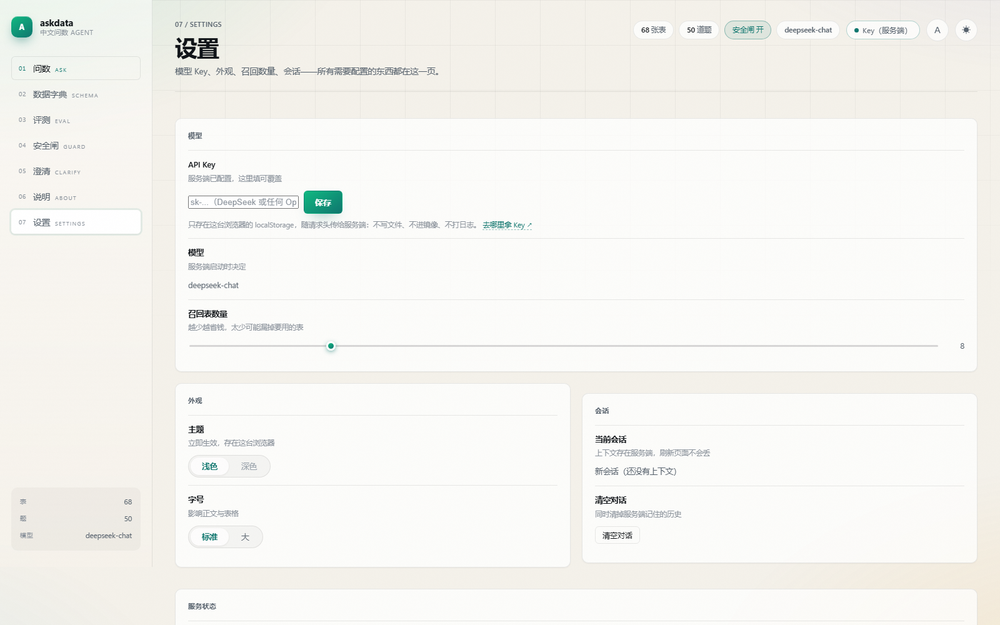
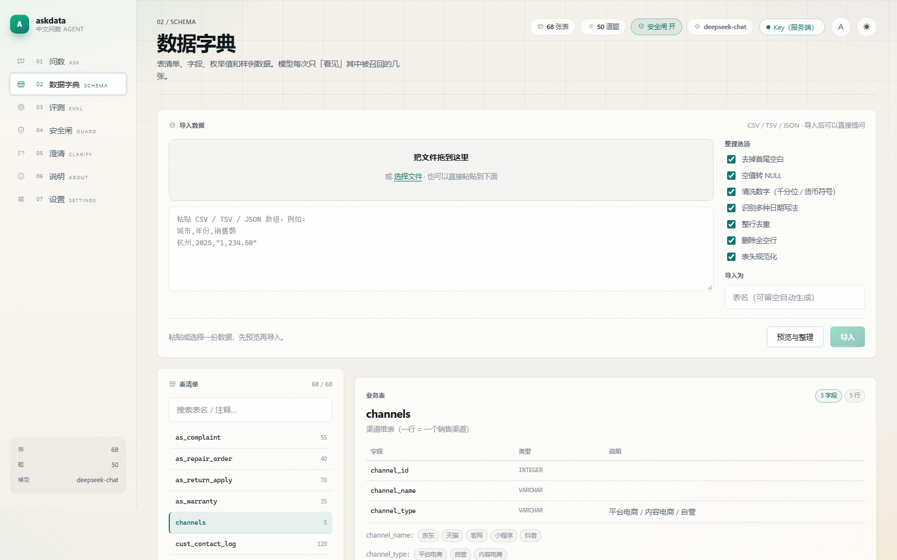
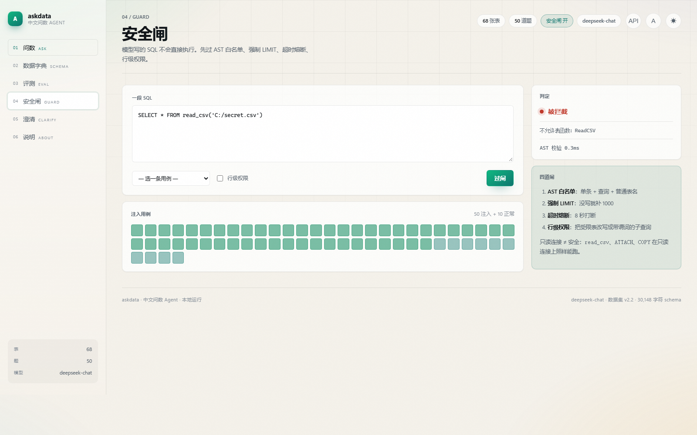
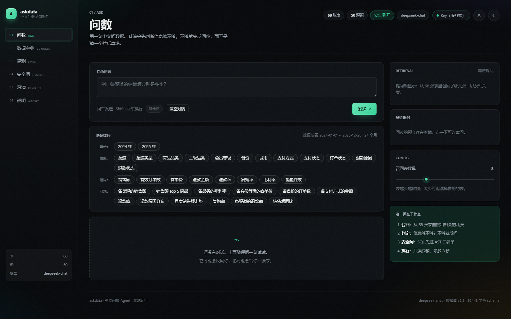

# askdata · 中文 Text2SQL 问数 Agent

<!-- CI 徽章在第一次 push 后会自动变色；绿色代表全流程通过 -->
[](https://github.com/f1sh59/askdata/actions/workflows/ci.yml)


把「自然语言问题」变成「能在数据库里跑出正确答案的 SQL」——并且**每一步都有可复现的分数**。

这个项目不是又一个「接个 LLM 就能问数据」的 demo。它的核心是一套**评测闭环**：
50 道中文业务题、一份确定性生成的数据集、一个把结果集比对做得足够严谨的打分器。
所有改进都必须先在这个闭环上跑出数字，才有资格叫改进。

> 当前进度：**P10 完成**（baseline → LLM → 自纠 → 召回 → 安全闸 → 澄清 → 导入 → few-shot → 多轮 → 结果校验），
> 另有服务端会话、SSE 流式输出、可选的鉴权与行级权限。

## 一条命令跑起来

```bash
docker compose up -d --build      # 然后打开 http://127.0.0.1:8777
```

第一次启动会现场生成数据库（约 30 秒），日志里能看到进度：

```
[entrypoint] 数据库不存在，开始生成：/app/data/askdata.duckdb
built /app/data/askdata.duckdb
  orders          9748
[entrypoint] 数据库生成完成
```

数据库放在 **Docker 卷**里（`askdata-data`），建容器不丢数据；想留在宿主机上，
把 `docker-compose.yml` 里的卷改成 `./data:/app/data` 即可。

> 国内网络注意两点：
> 1. 拉基础镜像慢，可以在 Docker Desktop 里配代理，或加 `"registry-mirrors"`；
> 2. 装依赖慢，构建时换 PyPI 源：
>    ```bash
>    docker build --build-arg PIP_INDEX_URL=https://mirrors.huaweicloud.com/repository/pypi/simple -t askdata .
>    ```

不想用 Docker 也行（只需要 Python 3.12+ 和两个依赖）：

```bash
pip install -r requirements.txt
python scripts/build_db.py        # 造数据，固定种子，可重复
python -m askdata.server --port 8777
```

Windows 上还有一键脚本（会自动检查环境、建库、起服务，并打印局域网地址）：

```powershell
pwsh scripts/deploy.ps1           # 启动
pwsh scripts/deploy.ps1 -Stop     # 停止
```

## 配置模型 API Key

不需要先建 `.env` 才能用界面——**两种方式任选**：

**方式一：界面里填（推荐给使用者）**

打开页面 → 右上角 `API` → 粘贴 Key → 保存。

```
只存在这台浏览器的 localStorage 里
每次请求通过 X-API-Key 头带给服务端
服务端只用于当次调用，不落盘、不写日志、不进镜像
```

好处是：换个人用、换台机器用，各自填自己的 Key，服务端不用重启，也不用共享一份密钥。



也可以直接把 `?key=1` 拼在地址后面，把「去填 Key」的链接发给别人：
`http://<主机>:8777/?key=1`

**方式二：服务端配置（推荐给部署者）**

```bash
cp .env.example .env      # 填入 DEEPSEEK_API_KEY
python -m askdata.server --port 8777
```

配好之后所有人共用这一份 Key，界面上的 `API` 按钮就不再是必须的。

> 两种方式可以并存：请求头带了 Key 就用请求头的，没带才用服务端环境变量。
> 都没有时接口返回 `400` 且带 `need_api_key: true`，界面会自动弹出配置栏，
> 而不是报一个看不懂的 500。

## 接口文档

服务起来后访问 **`/docs`**，或者直接拿 `/api/openapi.json` 喂给任何支持 OpenAPI 3.1 的工具。



文档不是手写的，而是从 `askdata/api_spec.py` 里的接口清单生成——
**同一份清单也被测试用来防止漂移**：

```python
# tests/test_api_spec.py
test_every_endpoint_exists_in_server   # 清单里有的，源码里必须真有这个路径
test_server_routes_are_documented      # 源码里有的，清单里必须登记
test_all_refs_resolve                  # 所有 $ref 都能解析，不会渲染成 {"$ref": ...}
```

两条反向检查一起用，才拦得住"加了接口忘了写文档"和"文档写了接口没做"。

## 工程规范与可观测性

一个人做项目最容易糊弄自己的地方是"能跑就行"。这一节是把它拉到能被别人接手的水准。

### 三道质量门（本地一条命令）

```bash
make check      # = make lint + make typecheck + make test-cov
```

| 门 | 工具 | 现状 |
|---|---|---|
| 代码风格 | `ruff` | 全绿（含 `tests/` `scripts/`） |
| 类型检查 | `mypy` | 26 个源文件 0 错误 |
| 测试 + 覆盖率 | `pytest` + `coverage` | 覆盖率门槛 58%（棘轮，只升不降） |

配置全在 `pyproject.toml`：项目元数据、依赖、`[project.scripts]` 入口、
ruff / mypy / pytest / coverage 的规则。`pip install -e ".[dev]"` 一次装齐。

### 探针与指标

```bash
curl localhost:8777/health    # 存活：进程在就行
curl localhost:8777/ready     # 就绪：还要数据库真的能查
curl localhost:8777/metrics   # Prometheus 文本格式
```

`/ready` 不是简单的 `return 200`——它会真的执行一条 `SELECT 1`，
避免"容器在、但查询全挂"还继续接流量。

指标包含：请求数（按方法/路由/状态码）、耗时直方图、业务事件计数。
没有引第三方库，Prometheus 文本格式自己拼——**零依赖是设计约束**。

### 请求 ID 与结构化日志

每个响应都带 `X-Request-Id`，同一个 ID 会出现在这一条请求的日志里：

```bash
ASKDATA_LOG=json python -m askdata.server
# {"ts":1763..., "level":"info", "event":"http_request",
#  "request_id":"d9388ec68aa2", "method":"GET", "route":"/api/overview",
#  "status":200, "ms":3.1}
```

### 限流

按客户端 IP 的令牌桶，默认 20 req/s、突发 60。超限返回 `429` + `Retry-After`。

> 默认值是按"打开一个页面会并发 5~8 个接口"定的。第一版设的 5/s 一上线就把
> 正常的页面加载挡了——限流阈值必须按真实调用模式定，不能拍脑袋。

### 统一错误码

```json
{"ok": false, "error": "问题不能为空", "code": "bad_request"}
```

前端只展示 `error` 文案，接入方按 `code` 分支，不用去匹配中文。

## 架构

```
                     ┌──────────────────────────────────────────┐
   浏览器（6 个页面） │  问数 · 数据字典 · 评测 · 安全闸 · 澄清 · 说明 │
                     └───────────────────┬──────────────────────┘
                                         │ 标准库 ThreadingHTTPServer（零构建，无 npm）
                     ┌───────────────────▼──────────────────────┐
                     │              askdata.server               │
                     └───────────────────┬──────────────────────┘
                                         │
        ┌────────────────────────────────▼───────────────────────────────┐
        │                        Pipeline（service.py）                   │
        │                                                                 │
        │  ① 改写追问   ② 表召回(BM25+RRF)   ③ 模型生成   ④ AST 白名单     │
        │  ⑤ 强制 LIMIT ⑥ 超时中断          ⑦ 行级权限   ⑧ 执行 + 比对     │
        └───────┬──────────────────────┬──────────────────────┬──────────┘
                │                      │                      │
        ┌───────▼───────┐      ┌───────▼───────┐      ┌───────▼────────┐
        │  DuckDB 文件库 │      │  DeepSeek API │      │  评测与报告     │
        │  单文件、嵌入式 │      │  OpenAI 兼容   │      │  43 份实测产物   │
        └───────────────┘      └───────────────┘      └────────────────┘
```

设计上的三个取舍：

- **不做微服务**：DuckDB 是嵌入式文件库，整个系统只有一个进程、两个运行时依赖——
  别人 clone 下来就能跑，不用起 MySQL/Redis/向量库。
- **前端零构建**：原生 JS/CSS + 标准库 HTTP 服务，没有 npm、没有打包、断网可用。
- **所有结论落盘**：评测、安全、澄清、多轮的每一次运行都写成 `reports/*.json`，
  界面直接读这些文件，所以**浏览页面不会产生任何模型调用费用**。

---

## 界面

| 问数 | 评测 |
|---|---|
|  |  |
|  |

| 数据字典 | 安全闸 |
|---|---|
|  |  |

暖白画布 + 四层渐变光晕 + 玻璃面板；日间 / 夜间双主题，可切字号。

夜间模式（同一页面，`?theme=dark`）：



截图是真机渲染，不是设计稿。改完样式重跑一条命令就能对比：

```powershell
pwsh scripts/screenshot.ps1            # 6 页 × 日夜 = 12 张，输出到 docs/shots/
pwsh scripts/screenshot.ps1 -Only ask  # 只截一页
```

---

## 1. 现在到多少分了

数据库有 **67 张表**（7 张业务表 + 60 张无关表，见第 5 节）。50 道题的 Execution Accuracy：

| 策略 | 交给模型的表 | EX（3 次重复，未用缓存） | prompt tokens / 题 |
|---|---|---|---|
| 关键词模板（无 LLM） | — | 18.0% (9/50) | — |
| 全量注入 | 67 张 | **90.0% ± 2.0**（88 / 90 / 92） | ≈10,800 |
| 表召回 Top-15 | 15 张 | 87.3% ± 1.2（86 / 88 / 88） | ≈3,300 |
| 全量 + 执行反馈自纠 | 7 张（旧库） | 94.0%（单次） | ≈2,150 |

> 前两行的区间是同一配置跑 3 次的真实波动。**单次跑分只应被当作这个区间里的一个样本**，
> 这也是为什么 P2' 阶段"Top-6/10/15 = 86/88/86"看起来毫无规律——它就是噪声。

---

## 2. 模型没变，分数从 66.7% 涨到了 94%

这是整个项目里最值得讲的一件事：**从头到尾只用了同一个模型、同一套 prompt 结构，分数涨了 27 个百分点，其中没有一个点来自模型**。

| 版本 | 改了什么 | 分数 |
|---|---|---|
| v1（30 题） | — | 66.7% |
| v1.1 | 澄清 9 道题的「要几列、百分比还是小数」 | 83.3% |
| v2.0（50 题） | 扩题 | 86.0% |
| v2.1 | 补语义层第 8 条 + 2 道题口径 | 88.0% |
| v2.2 | 修正 h15 题面与 gold 的矛盾 | 90.0% |

每一分都来自「把尺子校准」，而不是「把模型调好」。第一次跑分时 10 道失败里有 6 道是我的 gold 多要了列、漏写了单位；最后一次只剩 1 道是模型真不会的。

**这就是为什么没有可信评测的 AI 项目，分数没有意义。**

---

## 3. P3：执行反馈只能修"跑不起来"的错

自纠循环：生成 → 只读沙箱执行 → 报错就把数据库返回的**原文错误**追加到 prompt 里让它改 → 再执行，最多 3 次。

| | 一次通过 | 自纠后 | 修复 | 改坏 |
|---|---|---|---|---|
| 50 题（旧库） | 90.0% | **94.0%** | m10、h08 | 0 |

它修好了所有"SQL 跑不起来"的题，一次都没把对的改坏；但对"跑得起来但算错了"完全无能为力——
那类错误在执行反馈这一侧看不到任何异常信号。

---

## 4. P1.5：扩题没能制造难度

加了 20 道更复杂的题（3 个月移动平均、渠道排名变化、累计退款率、组内 Top1/Top2 差距、多品类退款按明细金额分摊……），预期分数掉到 60~70%。

实际：**ext20 拿到 19/20，和 core30 的 28/30 没有区别。**

结论：**在「schema 全给 + 业务口径全给」的前提下，SQL 复杂度已经不是瓶颈了。**
难点在别的地方——信息缺失、口径缺失、schema 规模。所以有了下面的 P2'。

---

## 5. P2'：schema 规模实验

### 怎么造的

往库里加了 **60 张结构合法、但与本项目无关的表**：客户、商品、库存、物流、营销、财务、售后、系统八个域。
其中交易域、财务域、售后域是**硬负样本**——`ods_order_ext`、`fin_refund_audit`、`as_return_apply`
这些表名和字段都在跟问题里的关键词抢词，召回器只做字面匹配时很容易认错。

Schema 从 **4,243 字符涨到 29,926 字符（7 倍）**，单轮 prompt 从约 2k tokens 涨到 10.8k。

### 召回器

两路信号 + RRF 融合（k=60）：

* **metadata 路**：表名、表注释、字段名、字段注释；
* **value 路**：枚举值（`status` 里真的躺着「已退款」才算数）。

第二路是故意的：`refunds` 和 `fin_refund_audit` 在元数据上很像，
但前者的数据里真有「已退款」这个状态值，后者只是审核日志。只做元数据匹配分不出来。

> 这里没有真向量检索：当前环境拿不到 embedding 服务（DeepSeek 不提供、pip 装不了本地模型）。
> 两路都是字面信号，`TableIndex` 的接口是留给向量版的。

### 表召回率（纯离线计算，无采样噪声）

| Top-K | 表召回率 | 所需表全命中 | 平均 prompt 字符 |
|---|---|---|---|
| 3 | 57.3% | 22/50 | 1,928 |
| 6 | 85.4% | 40/50 | 3,536 |
| 8 | 95.5% | 46/50 | 4,621 |
| 10 | 97.8% | 48/50 | 5,443 |
| **15** | **100%** | **50/50** | **7,537** |
| 67（全量） | 100% | 50/50 | 29,926 |

**K=15 就能把题目需要的表全部召回，prompt 只有全量的 25%。** 这是确定性指标，没有噪声。

### 那准确率呢——分不出来

| | 全量 67 张 | Top-6 | Top-10 | Top-15 |
|---|---|---|---|---|
| EX | 92.0% | 86.0% | 88.0% | 86.0% |

四个数里 Top-6/10/15 是 **86 → 88 → 86**，非单调。这不可能是"召回越多越准"或者"越少越准"，
只能是噪声——同一 prompt 两次跑差 2~3 题，这个波动我在 P3 阶段就测到过。

所以诚实的结论是：

1. **加 60 张无关表，准确率没有下降**（7 张表时 90%，67 张表时 92%，差 1 题，在噪声内）。
   说明模型在 1 万 token 的 schema 里并不会被无关表干扰——"表多了模型就选错表"在这个规模上不成立。
2. **召回的价值是成本**：Top-15 省 70% prompt tokens，表召回仍然 100%。
3. **延迟没有变化**：全量 61.9s / Top-15 62.2s，都是 1.24s 一次调用。
   瓶颈在生成，不在读 prompt——所以"缩短 prompt 让响应更快"这个直觉也是错的。
4. **要证明准确率上的差异，这个评测集太小了。** 50 道题、±3 题的噪声，分辨不出 2~3 个点的效应。

第 4 条是这一轮真正的产出：我做了一个实验，实验告诉我"你的实验不够可靠"。

---

## 6. P6：给分数装上置信区间

P2' 结束时有个尴尬的处境：四个配置的分数是 92 / 86 / 88 / 86，而我知道同一配置两次能差 2 题。
**在 ±3 题的噪声上比较 2~3 个点的差异，和抛硬币没有区别。**

所以这一步不再加功能，只做测量。

### 重复运行

`--repeat N` 把同一配置独立采样跑 N 次（强制关缓存），报告均值、标准差、区间，以及**每道题在 N 次里对了几次**。

| 配置 | 第 1 次 | 第 2 次 | 第 3 次 | 均值 ± 标准差 |
|---|---|---|---|---|
| 全量注入（67 表） | 88.0% | 90.0% | 92.0% | **90.0% ± 2.0** |
| 召回 Top-15 | 86.0% | 88.0% | 88.0% | **87.3% ± 1.2** |

50 道题里：

* 全量注入：**44 题 3/3 稳定通过**，3 题 0/3 稳定失败（h05、h08、h13），3 题在中间跳（h03、h07、m15）；
* 召回 Top-15：43 题稳定通过，5 题稳定失败，2 题跳（m13、h15）。

**这 3 道跳变的题，就足以让 EX 在 88%~92% 之间浮动。** 之前所有"涨了两个点"的观察，量级都在这之内。

### 配对 bootstrap

重复运行只估计了采样噪声，还有一层是"50 道题本身就是个样本"。用配对 bootstrap
对题目做有放回重采样，看两个配置的差值区间是否跨过 0（`scripts/compare_runs.py`）：

```
A = llm        (mean EX 90.0%, n=3)
B = llm-linked (mean EX 87.3%, n=3)

均值差 (A - B) : +2.7 pt
95% CI         : [-2.0, +8.0] pt
P(差值 <= 0)   : 0.164

结论：区间跨过 0，差异不显著 —— 不能宣称 A 比 B 好。
```

### 所以 P2' 该怎么收尾

| | 全量注入 | 召回 Top-15 |
|---|---|---|
| EX | 90.0% ± 2.0 | 87.3% ± 1.2 |
| prompt tokens / 题 | ≈10,800 | ≈3,300（**省 70%**） |
| 表召回率 | 100% | 100% |
| 单次调用耗时 | 1.24s | 1.16s |

诚实的结论是两条：

1. **成本上的收益是确定的**：prompt tokens 少 70%，表召回 100%——确定性指标，没有噪声。
2. **准确率上的差异没能被证明**：区间是 [-2.0, +8.0]，既不能说召回更差，也不能说一样好。
   按这个区间宽度，要靠 50 道题下结论是不够的。

第 2 条比第 1 条更有价值：**"测不出来"是一个结论，而"我觉得它更好"不是。**

---

## 7. P4：四道闸

沙箱原先只有"只读连接 + 禁止多语句"，这不够。**只读连接不等于安全**：
`read_csv('C:/secret.csv')` 能读进程能读的任何文件，`ATTACH` 能挂外部库，`COPY ... TO` 能写文件，
这些在只读连接上照样跑得动。

所以做成四道闸，全部收在 `askdata/guard.py` + `askdata/db.py` 里：

| 闸 | 机制 | 验证 |
|---|---|---|
| AST 白名单 | sqlglot 解析后：**只允许单条**、根节点是 `Select`/`Union`、表只能是普通标识符 | 50 条注入用例，拦截 50/50 |
| 强制 LIMIT | 没写 LIMIT 的查询补 `LIMIT 1000` | 有 LIMIT 时保持原样 |
| 超时熔断 | 定时器到点调 `connection.interrupt()` | 0.5s 超时 → 0.61s 中断，连接仍可用 |
| 行级权限 | 受限表改写成 `(SELECT * FROM t WHERE 谓词) AS t`，别名不变 | 别名与列引用保持不变 |

**白名单而不是黑名单**，是这一节最重要的设计判断：黑名单（"禁止 DROP"）永远堵不完，
`PRAGMA`、`INSTALL`、`read_csv` 随便漏一个就能读到文件系统。而"单条 + 查询 + 普通表名"
这三条一卡，绝大多数危险面直接消失。

### 拦截效果

```
blocked 50/50 allowed 10/10
```

50 条用例覆盖：DDL（含大小写混淆 `DrOp TaBlE`）、DML、`PRAGMA`、`ATTACH`/`DETACH`、
`COPY ... TO`、`read_csv`/`read_parquet`/`read_json`/`glob`/`sqlite_scan`、`INSTALL`/`LOAD`、
`SET`、堆叠语句（`SELECT 1; DROP TABLE orders`）、注释绕过、事务与管理命令、系统函数当表用。

同时验证**没有误伤**：10 条正常查询（CTE、UNION、窗口、JOIN、`TIMESTAMP` 字面量、引号标识符、
小写关键字、带分号结尾）全部放行，而且 **50 道 gold SQL 也全部通过闸门**。

一个容易忽略的细节：闸门挡下的 SQL 不抛异常，而是返回带 error 的 `QueryResult`，
被记成一次普通的 `sql_error`。否则一条恶意 SQL 就能让整轮评测崩掉——这对安全组件尤其重要：
**它不能成为新的故障源。**

### 已知局限

- 行级权限只做单表谓词改写，CTE/子查询里的受限表能覆盖，但**算子下推后的推导性泄露**防不住
  （比如用不受限表的聚合反推受限表的数据）；
- 白名单会拦掉 `duckdb_settings()`、`range()` 这类表函数，正常业务查询用不到，
  但如果将来要支持元数据查询，需要单独开白名单；
- 超时是"到点中断"而不是"查询预算"，中断后 DuckDB 再执行下一条是安全的，但正在进行的大查询会被直接打断。

---

## 8. P5：该问就问，不该问别问

前面的结论指向一件事：**schema 和口径都给全时，SQL 复杂度不再是瓶颈**。
那真实场景的失败从哪来？从"用户没说清楚"来——他不会问"2025 年各渠道销售额"，
他只会问"最近卖得怎么样"。

P5 让系统在信息不足时**先反问**，而不是猜一个然后算错。

### 两类题必须一起测

只测"该问的有没有问"，会得到荒谬的结论：一个永远反问的系统能拿 100%。

| 题集 | 题数 | 期望行为 |
|---|---|---|
| vague（挖掉时间/指标/口径） | 15 | 必须反问，且问到缺失的点上 |
| control（原有 50 题，信息完整） | 50 | 不许反问，必须直接出 SQL |

### 结果

```
vague=15  追问率=100%  问到点上=93%
control=50  误反问率=0%
```

| 指标 | 值 |
|---|---|
| 追问率 | 100%（15/15） |
| 问到点上（覆盖全部缺失点） | 93.3%（14/15） |
| 猜测率（不追问直接给 SQL） | 0% |
| **误反问率（完整题被反问）** | **0%（0/50）** |

反问质量抽查（`reports/clarify_*.md` 第 3 节有全部原文）：

> 用户问「商品利润排行」
> → 请问商品利润排行的时间范围是什么？利润口径如何计算（例如：销售额按 `order_items.item_amount` 汇总减去成本 `cost × quantity`，还是其他口径）？排行按利润金额降序取前多少名？

它不只是问"你要什么"，而是**用 schema 里的真实字段把可选项列出来**——比一堆"请补充信息"有用得多。

同时抽查了 control 组：50 道题全部 `need_clarification=false` 且 **SQL 非空**（161~1422 字符）。
"不反问"不是"既不问也不答"。

### 判分方式，以及它的局限

用**关键词覆盖**判断"有没有问对地方"：每道 vague 题标注缺失的槽位（时间范围/指标/口径），
再看反问问句里有没有出现对应关键词。不用 LLM 当裁判，理由是可复现、零成本、可解释。

代价是它很粗暴：

* 只能判断"问到了时间范围"，判断不了"问得好不好"；
* v13「今年做得好吗？」只拿到 partial：我标的槽位是"跟什么比"，模型问的是"按什么维度拆"——
  **槽位设计本身带主观性**，这一分不该全算模型的；
* **最关键的一条**：0% 误反问只说明它没在"我认为完整"的题上乱问，
  并不说明它在"真正有歧义"的题上会问。h03（列数约定）和 h13（整单退款怎么算）
  我自己都知道有歧义，它却直接选了一种解释——按这个指标算"合格"，按人的标准未必。

### 已知局限

- 只测了"该不该问"，没测"问了之后能不能收敛"：用户回答"2025 年"之后，
  系统能不能接着给出正确 SQL，这一环还没验证；
- 槽位关键词是人工标的，覆盖不全就会误判成 partial。

---

## 9. P5.5：问了之后，收敛了吗

P5 证明了"该问就问"，但没证明"问了有用"——一个只会反问的系统同样能拿 100% 追问率。

### 实验设计

15 道含糊题各配一条"用户补充回答"和一份 gold SQL，跑两条路：

| 路线 | 做法 |
|---|---|
| 不问，直接写 SQL | 把含糊问题直接丢给模型（现有 P1 策略） |
| 先反问一轮再写 | 第一轮判断要不要问；用户补充后，把「原问题 + 反问 + 补充」一起交给模型 |

### 结果

```
baseline（不问直接答）  = 0/15  (0%)
closed-loop（问一轮再答）= 13/15 (87%)
```

**baseline 全错不是偶然**：面对「最近销售额怎么样」，模型的默认行为是**猜**——
猜 2025 年、猜按销售额、猜返回几列。三个假设里错一个，EX 就是 0。
这就是"不问"的真实成本：它不是"答得糙一点"，而是**稳定地答错**。

反问一轮之后，13 道题直接对上了预先写好的 gold。

### 剩下的 2 道是模型真错

v07（各会员等级表现）和 v08（同比）都把语义层第 8 条——"品类/商品维度的销售额用明细金额汇总"——
**过度套用**到了"会员等级"和"年度"维度上，那里应该按第 2 条用 `pay_amount`。

有意思的是：这条规则是 P2' 阶段为了修 join 扇出才加进去的，现在它自己变成了新的错误来源。
**规则越具体，越需要写清适用边界。**

### 这一轮我又改了 4 次口径

首轮 10/15，5 道失败里：

* 3 道是我的 gold 列顺序与自己写的用户回答相反（回答写"销售额和订单数"，gold 却返回"订单数、销售额"）；
* 1 道是"退款率"没说单位（模型返回小数 0.08，gold 是百分比 8.2）；
* 1 道是回答没写清"只要增长率这一个数"。

修到 13/15 之后停手：剩下两道是模型真错，不该再改题。
这是第四次踩同一个坑——**题面、gold、用户回答是同一个规格的三个副本，任何一处不一致都是评测集的 bug。**

### 局限

- 用户补充回答是脚本化的，不是真交互：如果模型的追问和预设回答对不上（比如它问"要不要按渠道拆"，
  而我答的是"2025 年"），这一轮就失真了；
- 只测了一轮澄清，没测"问了一次没问清楚、再来一轮"；
- 15 道题太少，87% 的置信区间很宽——这正是 P6 那条教训。

---

## 10. 数据模型

67 张表。7 张业务表：

```
channels ──┐
           ├──< orders ──< order_items >── products
users ─────┘        │
                    ├──< payments
                    └──< refunds
```

| 表 | 行数 | 说明 |
|---|---|---|
| `channels` | 5 | 渠道维表（天猫/京东/抖音/官网/小程序） |
| `users` | 600 | 用户，含软删除标记、可空的城市/会员等级 |
| `products` | 90 | 商品，含成本价、上下架状态 |
| `orders` | 9,748 | 订单头，含状态机与折扣前/后两种金额 |
| `order_items` | 16,402 | 订单明细 |
| `payments` | 9,318 | 支付流水，含失败与退款状态 |
| `refunds` | 893 | 退款单，含处理中/已拒绝状态 |

另 60 张无关表由 `scripts/build_db.py` 的 `DECOY_TABLES` 生成（客户/商品/库存/物流/营销/财务/售后/系统域），
每张 10~160 行，只为把 schema 规模撑起来。

全部数据用固定种子生成，**任何人跑出来完全一致**。评测集的 gold SQL 是对着这份数据写的，数据一变所有历史指标作废。

---

## 11. 业务口径

口径写在 `data/schema.sql`，同时以**语义层**的形式注入 prompt（`askdata/schema.py` 的 `BUSINESS_RULES`）：

| 概念 | 定义 | 常见错误 |
|---|---|---|
| 有效订单 | `status IN ('已支付','已发货','已完成')` | 把已取消、待支付也算进销售额 |
| 销售额 / GMV | 有效订单的 `pay_amount` 之和 | 用 `total_amount`（折扣前） |
| 品类销售额 | 明细 `order_items.item_amount` 汇总 | 直接 JOIN 后 `SUM(pay_amount)`，金额被明细行数重复累加 |
| 退款金额 | `refunds.status='已完成'` 的金额 | 把"处理中""已拒绝"也算进去 |

模型在 **join 扇出**上连摔两次（`orders JOIN order_items` 后对 `pay_amount` 求和）。
补进语义层之后这个坑就不再考"悟性"，只考"有没有读文档"——这是语义层该做的事。

---

## 12. 刻意保留的脏数据

- `users.city`、`users.member_level` 有 NULL（约 8% / 5%），直接 `GROUP BY` 会丢行；
- `users.is_deleted = TRUE` 的软删除用户，其历史订单**依然有效**；
- 2% 的订单 `total_amount` 与明细汇总对不上；
- 15% 的商品已下架，但历史订单里仍然出现；
- `orders.order_time` 是 `TIMESTAMP`，`users.register_date` 是 `DATE`。

---

## 13. 指标定义

**Execution Accuracy（严格）**：把预测结果集与 gold 结果集当作行的多重集比较——行序无关、
列数必须一致、数值四舍五入到 2 位、重复行有意义（用 `Counter` 而非 `set`）。

**为什么不用字符串相似度**：`SUM(pay_amount)` 与 `SUM(total_amount)` 只差几个字符却错了十万八千里。
Text2SQL 唯一可信的评分方式是执行结果比对。

---

## 14. 快速开始

需要 Python 3.11+（本项目在 3.14 上验证），以及一个 DeepSeek API Key。

```powershell
python -m venv .venv
.venv\Scripts\python.exe -m pip install -r requirements.txt

copy .env.example .env                                   # 填 DEEPSEEK_API_KEY
.venv\Scripts\python.exe scripts\build_db.py --verify    # 67 张表
.venv\Scripts\python.exe -m askdata.cli validate
.venv\Scripts\python.exe -m askdata.cli attack                   # 50 条注入用例

.venv\Scripts\python.exe -m askdata.cli eval --strategy template
.venv\Scripts\python.exe -m askdata.cli eval --strategy llm                 # 全量注入
.venv\Scripts\python.exe -m askdata.cli eval --strategy llm-linked --top-k 15
.venv\Scripts\python.exe -m askdata.cli eval --strategy llm-selfcorrect
.venv\Scripts\python.exe -m askdata.cli clarify            # 该反问时有没有反问
```

常用开关：

```powershell
--ids h05,h13          # 单题调试
--repeat 3             # 重复跑 3 次，输出均值/标准差/每题稳定性（自动关缓存）
--no-cache             # 关缓存重新采样
--top-k 15             # 召回表数量
--max-rounds 5         # 自纠最多尝试次数
schema --out reports\schema_context.txt   # 看模型实际收到的语义层
```

比较两份重复报告（配对 bootstrap）：

```powershell
$env:PYTHONPATH='.'
.venv\Scripts\python.exe scripts\compare_runs.py `
    reports\repeat_llm_20261118_191122.json `
    reports\repeat_llm-linked_20261118_191420.json
```

跑测试：`.venv\Scripts\python.exe -m unittest discover -s tests -t .`（77 个）

### 起一个能点的界面

```powershell
.venv\Scripts\python.exe -m askdata.server --port 8777
# 打开 http://127.0.0.1:8777
```

零构建：Python 标准库起服务 + 原生 JS/CSS，不依赖 npm、CDN，断网也能跑。
右上角可切换**日间 / 夜间**（默认日间，选择存在 localStorage）。

| 页面 | 干什么 | 要不要花 token |
|---|---|---|
| **01 问数** | 真提问：召回哪几张表、有没有反问、SQL、**结果柱状图**、结果表、每阶段耗时；可复制 SQL / 下载 CSV；本地留提问历史 | 要（每次 1~2 次调用） |
| **02 数据字典** | 67 张表的字段、类型、注释、枚举值、样例数据，支持搜索；顶部可**导入数据** | 不要 |
| **03 评测** | 评测历史趋势曲线 + 50 题热力图 + 分难度指标 + 逐题明细，可切换任意历史报告 | 不要 |
| **04 安全闸** | 写一段 SQL 看它过不过闸；60 条用例点一下就试；可开关**行级权限**看改写结果 | 不要 |
| **05 澄清** | 15 道含糊题 + 它实际的反问原文；闭环 0% → 87% 的对比 | 不要 |
| **06 说明** | 十个阶段、链路图、规模、三句话总结 | 不要 |

只有「问数」会真的调模型，其余页面读的都是已经跑出来的报告——**这样打开页面不会被意外扣费**。

### 验收（一条命令跑完）

```powershell
# 服务起好后
python scripts/acceptance.py          # 51 项接口级验收（含问数/多轮，会花少量 token）
python scripts/acceptance.py --skip-llm   # 跳过花钱的部分
node scripts/frontend_audit.js        # 39 项前端渲染验收（用真实接口快照跑 DOM 模拟）
python scripts/stress_test.py         # 并发压测（串结果 / 锁竞争 / 超时自愈）
pwsh scripts/screenshot.ps1           # 六页 × 日夜 = 12 张截图，改完样式用来对比
python -m unittest discover -s tests -t .  # 96 个单测
```

验收脚本只走 HTTP，不 import 项目代码——验的是"用户真正能用到的东西"。
它自己在库里建表再删表，跑完不留垃圾。
### 多轮对话（P9）

问数默认是单轮的：每句话都当成新问题，所以"那 2024 年呢？"必然答错。
接上多轮的做法是**先改写再生成**：

```
用户：2025 年各品类的销售额     → 5 行
用户：那只看家电和数码呢？
      ↓ 改写追问（一次额外调用）
      "2025年家电和数码这两个品类的销售额分别是多少？"
      ↓ 走完全相同的单轮管线：召回 → 生成 → 安全闸 → 执行
      数码 | 10,486,843.51
      家电 | 11,374,138.69
```

改写层只加了一步，下游全部复用——所以它能被单独评测：

| 设置 | 追问准确率 |
|---|---|
| 单轮（不带历史） | **0.0%**（0/20） |
| 多轮（带历史，3 次均值） | **76.7%**（15/20 / 15/20 / 16/20） |

失败的 4 条里，**2 条是改写环节的问题**（丢维度、空输出），
2 条是答案表示问题（按月格式、并列名次），**没有一条是 SQL 写错**。
详见 `reports/multiturn_findings.md`。

```powershell
python scripts/build_multiturn.py            # 生成 20 条机械可验证的追问
python -m askdata.cli multiturn --repeat 3   # 单轮 vs 多轮
```

### 结果校验 Agent（P10）

问数最危险的错误不是"SQL 报错"，而是**跑成功了但数字是错的**——界面上就是一张
看起来很正常的表。多明细订单直接 `JOIN` 后 `SUM(pay_amount)` 就是典型：金额被按
明细行数放大，不抛任何异常。

所以执行完之后还有一道**校验环节**，零成本、每次都跑：

| 检查 | 抓什么 | 例子 |
|---|---|---|
| 量级 | 单值金额超过全库总额 3 倍 | `gmv = 128,000,000`，而全库有效订单总额只有 2,366 万 → 判定 join 扇出 |
| 空结果 | 聚合/排名题返回 0 行 | 时间范围或过滤条件写死了 |
| 负数 | 计数、金额出现负值 | `order_cnt = -5` |
| 比率越界 | 比率列 > 100% | `refund_rate = 132.5`，多半把金额当成了比率 |

命中就在答案**上方**弹一条提示（校验排在答案前面：数字可能错，先看见警告再看见数字），
链路里也会多一个阶段：

```
召回表 → 模型生成 → 安全闸 → 执行 → 结果校验
```

另外还提供可选的**大模型复核**（`verify.py` 里的 `build_verify_prompt`）：
把问题、SQL、结果摘要交给模型问一句"这看起来对吗"，用来兜住没预料到的怪。
默认不开，因为每次要多花一次调用。

```powershell
python -m unittest tests.test_verify -v      # 13 个用例
```

### 服务端会话（多轮记忆）

多轮的历史以前只存在浏览器 `localStorage` 里：换设备就没了、每次请求都要把整段历史
发上来、而且客户端还能随意改写上文。现在改成**服务端维护**：

```
客户端只带一个 session_id  →  服务端按 id 取最近 6 轮
```

实测（第二轮**刻意不传 history**）：

```
第 1 轮  2025 年各渠道的销售额分别是多少？   → 5 行，会话轮数 1
第 2 轮  那只看天猫呢？                    → 改写为「2025年天猫渠道的销售额是多少？」1 行，会话轮数 2
```

三个设计取舍：

- **内存态、不落盘**：会话是「这次对话」的临时状态，服务重启丢失可接受，也避免磁盘上留隐私；
- **有上限**：单会话 6 轮、全局 200 个会话、6 小时不用自动过期；
- **可手动清除**：界面上「清空对话」按钮，接口是 `POST /api/session/clear`。

```powershell
curl -X POST http://127.0.0.1:8777/api/session/clear -d '{"session_id":"..."}'
curl http://127.0.0.1:8777/api/session/stats
```

清空时**先清服务端再清界面**：反过来的话，万一服务端失败会出现"界面空了但模型还记得上文"这种更糟的状态。
### 流式输出（SSE）

一次问数要调模型，冷启动大概 1.3 秒。以前这段时间界面只有一行"处理中"，
现在每个阶段都实时推给前端：

```
[   15 ms] 首字节
[   16 ms] stage 召回表    8 张          ← 用户这时已经看到进度
[ 1287 ms] stage 模型生成  2467+157 tokens
[ 1289 ms] stage 安全闸    通过
[ 1340 ms] stage 执行      1 行
[ 1340 ms] stage 结果校验  通过
```

**首字节 15 ms，总耗时 1340 ms**——等待没有变短，但前 1.3 秒里用户一直有东西看。

接口是 `POST /api/ask/stream`，返回 `text/event-stream`：
`event: open` → 若干 `event: stage` → `event: result`（出错时是 `event: error`）。

用 SSE 而不是 WebSocket：这里只需要服务端单向推送，不必维护双向连接、心跳和重连，
还能直接复用现有的 HTTP 处理流程。

```powershell
python scripts/stream_probe.py "2025 年各渠道的销售额分别是多少？"   # 打印每个事件的到达时间
```

### 鉴权与行级权限

默认**不鉴权**（内网演示方便），两个环境变量能把它打开：

```powershell
$env:ASKDATA_TOKEN = "一串足够长的随机值"   # /api/* 都要带 Authorization: Bearer <值>
$env:ASKDATA_ROW_POLICY = "1"              # 所有查询都套行级权限
python -m askdata.server --port 8777
```

开启后实测：

```
GET  /api/overview  无 token   → 401
GET  /api/overview  对 token   → 200
GET  /api/overview  错/中文token → 401（不是 500）
GET  /                无 token   → 200（静态资源必须放行，否则页面都打不开）
```

行级权限的效果（deterministic，guard 层）：

```sql
-- 开了 ASKDATA_ROW_POLICY=1 之后
SELECT COUNT(*) FROM (SELECT * FROM "orders" WHERE channel_id IN (1, 2)) AS orders LIMIT 1000
```

界面上如果服务要求令牌，会弹一条输入框；令牌只存在浏览器本地，不对就提示重填。

> 这两个开关是**演示级**的：一个共享 token、没有用户体系、没有审计日志。
> 真实生产需要用户、角色、审计——写在文档里的限制比假装做全了更负责。
### 数据导入（企业即插即用）

数据字典页顶部可以拖入 / 粘贴数据，支持 **CSV、TSV、分号分隔、JSON 数组**，
解析后先预览、确认，再建表：

1. **自动识别**分隔符（`, ; \t |`）与 JSON 数组；
2. **整理**（可逐项开关）：去首尾空白、空值转 NULL、数字清洗（去千分位 / `￥` / `元`）、
   识别多种日期写法（`2025-01-05` / `2025/01/05` / `2025年1月5日`）、整行去重、删除全空行、表头规范化；
3. **推断类型**：整数 / 小数 / 日期 / 布尔 / 文本，每一列都可以手动改，也可以取消勾选不导入该列；
4. **导入后立即生效**：表名加 `imp_` 前缀，schema 与召回索引自动重建，**下一句就能直接问它**。

导入走的是服务端受信通道（`execute_trusted`），模型写的 SQL 依然要过 AST 白名单——
两条路严格分开。

> ⚠️ 导入需要可写连接，DuckDB 是单进程独占的：**服务以可写模式运行时，CLI 打不开数据库**。
> 要跑 CLI 评测就先停服务，或者用只读模式启动：
> ```powershell
> .venv\Scripts\python.exe -m askdata.server --port 8777 --read-only
> ```

---

## 15. 目录结构

```
askdata/
├── askdata/
│   ├── cli.py                  # validate / schema / eval
│   ├── db.py                   # 只读 SQL 沙箱
│   ├── scoring.py              # 结果集比对（EX 实现）
│   ├── runner.py               # 评测执行器、首轮/最终轮打分
│   ├── report.py               # Markdown / JSON 报告
│   ├── schema.py               # 数据库结构 + 业务口径 → 语义层
│   ├── retrieval.py            # 表级召回：BM25 × 2 + RRF
│   ├── experiment.py           # 重复运行、每题稳定性、报告
│   ├── stats.py                # 配对 bootstrap / 区间估计
│   ├── guard.py                # AST 白名单 / 强制 LIMIT / 行级权限
│   ├── attacks.py              # 50 条注入用例 + 10 条放行用例
│   ├── clarify.py              # P5/P5.5：该不该反问 + 闭环评测
│   ├── service.py              # 给前端用的服务层（把一次问数拆成阶段）
│   ├── imports.py              # 数据导入与整理（解析/清洗/类型推断/建表）
│   ├── server.py               # 标准库 HTTP 服务 + 静态托管（--read-only 可共存）
│   ├── llm.py                  # DeepSeek 客户端（重试 + 响应缓存）
│   └── strategies/
│       ├── template.py         # 关键词模板 baseline
│       ├── llm.py              # 全量 schema / 召回 schema 共用
│       └── selfcorrect.py      # 执行反馈自纠
├── web/                        # 零构建前端
│   ├── index.html
│   ├── styles.css              # 分析师控制台风格
│   └── app.js
├── data/schema.sql
├── eval/
│   ├── questions.json          # 50 题（唯一事实来源，版本与 revisions 在文件里）
│   ├── questions_v1.json       # 历史版本
│   └── questions_v1_1.json
├── reports/                    # 每次评测的报告（作为证据提交）
├── scripts/
│   ├── build_db.py             # 确定性造数 + 60 张无关表
│   └── bootstrap_deps.py       # 受限环境下的依赖安装兜底
└── tests/                      # 77 个单测
```

---

## 16. 路线图

| 阶段 | 内容 | 状态 |
|---|---|---|
| P0 | 数据、评测集、打分器、模板 baseline | ✅ 18% |
| P1 | 全量 schema + 零样本 LLM | ✅ 90.0% ± 2.0（67 表） |
| P3 | 执行反馈自纠 | ✅ 语法错误全修，语义错误无解 |
| P1.5 | 扩题到 50 题 | ✅ 但没能制造难度 |
| P2' | schema 规模实验 | ✅ 召回省 70% token，准确率分不出 |
| P6 | 重复运行 + 配对 bootstrap + 评测接 CI | ✅ 差异不显著，区间 [-2.0, +8.0] |
| P4 | 安全四道闸：AST 白名单、LIMIT/超时、行级权限 | ✅ 拦截 50/50，放行 10/10 |
| P5 | 多轮澄清：信息不足时反问 | ✅ 追问率 100%，误反问 0% |
| P5.5 | 澄清闭环：补充信息后能不能收敛 | ✅ 0% → 87% |
| **P7** | **工程化收尾：HTTP API + 前端 + 一镜到底的 demo** | 下一步 |

### 下一步为什么是 P7

到这里，方法论上能做的都做完了：有评测集、有统计、有闭环、有安全闸。
但它现在还只是一个**命令行工具箱**——要跑一次评测得敲五条命令，要看结果得翻 Markdown。

一个能被别人真正用起来的系统，至少需要：

1. 一个 `/ask` 接口：传问题 → 返回 SQL + 结果 + 是否要澄清；
2. 一个极简页面：输入框、SQL 高亮、结果表格、澄清气泡；
3. 一条命令起服务，和一个能演示的录屏。

这一步不加新算法，只把已有的东西组装成一个"能演示的成品"——
也是这个项目里唯一能被别人当场点开验证的东西。

### 已知局限

- h03 的列数约定仍未写清，h13 的"整单退款是否计入品类退款额"仍未约定；
- 表召回用的是字面信号，没有真向量检索；
- 重复实验只做了 N=3，置信区间仍然很宽；要把区间压到 ±2pt 需要几十次重复；
- 行级权限只能做单表谓词改写，防不住推导性泄露（见第 7 节）；
- 澄清闭环的用户回答是脚本化的，不是真交互（见第 9 节）。

---

## 17. 设计决策记录

| 决策 | 理由 |
|---|---|
| DuckDB 而不是 MySQL | 单文件、零部署、列存适合分析查询 |
| 50 题而不是 500 题 | 手写 gold SQL 成本极高；50 题足够区分"能做 9 题"和"能做 46 题"，且每题都能人工复核 |
| gold SQL 必须非空 | 空结果的题会让所有模型"全错"或"全对"，是噪声不是信号 |
| 主指标用严格 EX | 宽松指标容易被"列顺序碰巧对"的答案虚高 |
| 先做 baseline 再接 LLM | 没有对照点的提升无法证明 |
| 用 urllib 而不是 openai SDK | 这个环境 pip 装不了包；一次 chat 调用本来只要二十行标准库代码 |
| 按 prompt 哈希缓存响应 | 调 prompt 时没人愿意反复付费；也让实验可复现 |
| 语义层渲染必须确定性排序 | 踩过一次：枚举值按计数排序、样例没 `ORDER BY`，导致每轮 prompt 都不同、缓存全部失效 |
| RRF 里零分文档不参与排名 | 踩过一次：零分表按字母序拿到固定分数，`as_*` 系列挤掉了 `refunds` |
| 召回器做两路而非一路 | 单看元数据分不出 `refunds` 和 `fin_refund_audit`，值域信号才能分开 |
| 扩题失败也如实记录 | "加了难题但分数没掉"本身就是结论：瓶颈不在 SQL 复杂度 |
| 分不出差异就承认分不出 | 与其说"召回更准"，不如说"这个评测集测不出谁更准" |
| 报告里必须给每题通过次数 | 均值只告诉你"大概多少分"，通过次数告诉你"哪几道题在摇" |
| 配对 bootstrap 而不是比均值 | 两个配置跑的是同一批题，按题配对能把题目难度差异消掉，功效高得多 |
| 重复运行强制关缓存 | 缓存会让"重复"变成"重放"，测到的波动是 0，自欺欺人 |
| 闭环的用户回答写成脚本，而不是让 LLM 扮演用户 | 脚本化才能保证每题的可比性；代价是模型的追问和预设回答可能对不上 |
| 题面 / gold / 用户回答必须互相自洽 | 踩过四次：同一份规格写在三个地方，任何一处不一致都会把模型的正确行为判成错误 |
| 安全闸用白名单而不是黑名单 | 黑名单永远漏一条；"单条 + 查询 + 普通表名"三条一卡，大部分攻击面直接消失 |
| 被拦的 SQL 记成 sql_error 而不是抛异常 | 安全组件不能成为新的故障源——一条恶意 SQL 不该让整轮评测崩掉 |
| 拦截规则用节点类型名而不是类对象 | 不被 sqlglot 版本差异咬到；`Command` 这种"解析降级"的节点也能一并覆盖 |
